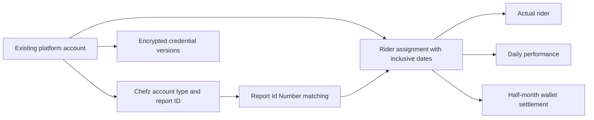

# Chefz — complete frontend implementation handoff

**Current integration contract (15 October 2026):** use the [accounts, two-account riders, performance and money handoff](chefz-accounts-reports-frontend-handoff-20261015.md), its TypeScript entry point and complete JSON examples. The hosted database passed 19/19 readiness checks; publishing the updated API remains required.

**15 October 2026 addition:** [Account status control](chefz-account-status-control.md) adds the admin status endpoint, automatic Available/Assigned behavior, reversible manual statuses, account row versions, and screen wiring. Use `status` for lifecycle badges/filters; `dashboardStatus` is now independent workbook metadata.

The [account list response](chefz-account-counts.md) also includes overall and per-sponsor counts by status and rider linkage, calculated across all accounts independently of pagination. These are backend changes only; frontend implementation is outside this request.

[Two accounts and report breakdowns](chefz-two-accounts-per-rider.md) now allows up to two active Chefz accounts on one rider. Money and performance responses identify each rider and each account separately alongside totals. FullTime charges remain 25 SAR per account per assigned day, as confirmed by the user.

**12 October 2026 addition:** [Detailed bulk settlement frontend handoff](chefz-order-settlements-frontend-handoff.md) covers automatic date cycles, actual-assigned-rider attribution, VAT/bonus/deduction calculations, upload states, complete response examples, and preview/save endpoints. The new application migration is applied and independently verified on hosted `db67927`; API deployment remains pending. See [the deployment record](chefz-order-settlement-hosted-deployment-20261012.md).

For the ten new workbook-related endpoints and expanded account contracts, use [the detailed frontend handoff](chefz-new-endpoints-frontend-handoff.md) and [TypeScript contracts](chefz-new-endpoints-contracts.ts). Hosted database changes are applied; deploying the updated API binaries is still required for hosted HTTP access.

**11 October 2026 additions:** Use [the workbook update contract](chefz-workbook-updates.md) for the settings, multi-half reports with missing-data messages, sponsor statistics table/CRUD, management report and owner reminder badges. Account responses also contain sponsor/city IDs, vehicle type, dashboard status, and an explicit `Unconfigured` account type when details are missing. Database changes are applied; API binary deployment and frontend screens remain separate deployment work.

**Updated:** 10 October 2026. **Audience:** frontend developers implementing the Chefz module in the existing Logistics ERP. **Language:** Arabic first, RTL, with English API identifiers. This is the implemented backend contract, plus the proposed screen and interaction specification. It does not imply those screens or the updated API binaries have been published.

## 1. Delivery status and platform identity

The hosted database `db67927` has been updated and verified directly through SQL:

| Migration | Status |
| --- | --- |
| `20261006155322_AllowLowerVehicleReturnOdometer` | Applied; this previously pending migration was processed first. It changes validation, without rewriting odometer data. |
| `20261010112122_AddChefzAccountsSettlementsAndPerformance` | Applied. |
| `20261010112140_GrantChefzPermissions` | Applied. |

The `chefz.AccountDetails`, `chefz.WalletSettlements`, `chefz.DailyPerformance`, and `chefz.PerformanceImports` tables exist. Their uniqueness indexes, four new permission definitions, and four `SYSTEM_ADMIN` grants were verified.

The existing hosted Chefz platform is:

| Property | Verified value |
| --- | --- |
| Platform ID | `01a02a0d-845d-7535-ac25-1e1f0c8e5808` |
| Platform code | `SHIFTZ` |
| Existing platform label | `شفز / Shiftz` |
| Non-deleted accounts at verification | 464 |
| Configured Chefz account details at verification | 0 |
| Saved Chefz settlements / daily performance rows | 0 / 0 |

Preserve that platform and its existing accounts. The backend recognizes `SHIFTZ`, `CHEFZ`, `THECHEFZ`, and `CHEFSZ`. Discover the platform from `GET /api/platforms`; use its returned ID rather than hard-coding the hosted ID in another environment. New Chefz type/password information requires operator input; the database update did not guess account types or import sample data.

The backend source includes the Chefz API, hosted-code compatibility, and a permission-handler fix for users with Chefz-specific client scopes. **Deploy the updated API application before connecting the frontend to the new endpoints.** This request updated the database and prepared the handoff; API application publication was not performed. A database migration alone does not add endpoints to an already-running older application.

## 2. Product scope and screen structure

Extend the current ERP shell, fonts, colors, navigation, permission system, density, and authentication client. Use the navigation label **شيفز** with three destinations:

| Proposed frontend route | Label | Main task | Primary action |
| --- | --- | --- | --- |
| `/chefz/accounts` | الحسابات | Configure existing accounts, credentials, and rider use | إعداد الحساب, within the selected row/detail |
| `/chefz/settlements` | التصفيات | Calculate and record each half-month's wallet settlement | تصفية جديدة |
| `/chefz/performance` | الأداء اليومي | Review daily imported offer statistics | رفع تقرير الأداء |
| `/chefz/accounts/:accountId` | تفاصيل الحساب | Account context, configuration, credentials, assignments, and related records | حفظ بيانات شيفز |

These are suggested frontend routes, not backend routes. Do not add another full platform-account management system. Reuse the ERP's existing account creation, sponsor/city selection, and rider assignment dialogs when the operator needs those actions.

Design for compact operational tables, readable Arabic labels, a restrained primary action, and clear status text. Keep registered owner and actual rider in separate columns. Financial forms should expose both wallet inputs before calculation. Use text with status colors, visible keyboard focus, logical CSS spacing, and a right-side navigation drawer in RTL. Render GUIDs, iqama/account IDs, passwords, dates, and numeric inputs in an LTR subregion. At narrow widths, use account/settlement detail cards or a labeled scrollable table; keep wallet inputs and results visible together. Do not shrink Arabic text to fit.

## 3. Identity and data relationships

| Identifier | Meaning | Frontend rule |
| --- | --- | --- |
| Base account `id` / Chefz `accountId` | Existing `PlatformRiderAccount` | Same GUID; use to join the two account responses. |
| `externalAccountId` | Platform's external account identifier | Display as text. It may differ from the report's identity number. |
| `reportIdNumber` | Exact matching key for Excel `Id Number` | String; preserve leading zeros. One active mapping per Chefz account identity. |
| `ownerRiderProfileId` / `ownerEmployeeId` | Registered account owner | Display as المالك المسجل; do not use as the performance recipient. |
| Base assignment `id` / Chefz `assignmentId` | A specific rider's account-use period | Required for settlement calculation. This is not the account ID. |
| `actualRiderProfileId` / Chefz `riderProfileId` | Rider using the account in that assignment | Use for performance/settlement attribution. This is not an employee ID. |
| `effectiveFrom` / `effectiveTo` | Inclusive assignment business dates | Historical assignment dates determine the recipient of a dated upload. |



Performance responses now include `riderName` and `externalAccountId`; order-import responses also identify riders. Join to the base account list for registered-owner names and use `/api/platform-accounts/{accountId}/assignment-history` for additional assignment context. Cache history by account ID and fetch on demand. Never attach a historical record to the account's current rider just because a current assignment exists. If a historical name cannot be resolved, display the saved identifier with a neutral fallback such as «مندوب سابق»; retain the record. The existing history query can omit archived rider/employee display records.

## 4. Transport, dates, amounts, and collection conventions

- Use the application's configured API origin. Base module path: `/api/chefz`. Send `Authorization: Bearer <access token>` through the existing authenticated request client. Password-change-required sessions must complete the existing password-change flow.
- Send `Accept: application/json` for data requests. JSON property names use `camelCase`. Chefz `accountType` is a **string**, exactly `Freelancer` or `FullTime`. `half` is a JSON integer, 1 or 2. Do not send enum integers for account type.
- Date fields are ISO calendar strings, `YYYY-MM-DD`. Business date validation uses Riyadh, UTC+03:00. Keep date-only values as strings; avoid converting them through UTC instants with `new Date(...).toISOString()`.
- All amounts are SAR, JSON numbers. Wallet amounts must be nonnegative and have at most two decimal places. Blank is missing; **zero is a valid input**. Do not send localized strings such as `"٥٠٠ ر.س"`.
- The backend calculates with `decimal`. Treat server preview/save results as authoritative. Keep money input as text until validation/conversion, and do not depend on JavaScript floating-point calculations for final financial values.
- `commissionRate: 0.15` means 15%. `acceptanceRate: 66.67` means 66.67%. These two percentage fields use different scales.
- Row versions are opaque Base64 strings. Do not decode, trim, increment, or reuse an account's base row version for Chefz details or an assignment.
- All Chefz JSON success responses are HTTP 200, except password PUT, which returns HTTP 204 with no body. The password GET response is a JSON **string**, not `{ password: ... }`.
- Chefz requests do not require an `Idempotency-Key` header. Use the replay behavior described below rather than copying Jahez's header workflow.
- Chefz lists default to page 1 / size 50, maximum size 100, maximum page 100000. The accounts list returns `ChefzAccountsResponse`, including `totalCount`, global `summary`, and per-sponsor `sponsors`. Other lists retain `{ items, page, pageSize }` without totals; fetch until a page contains fewer than `pageSize` rows when all their records are needed.
- The existing `/api/platforms`, `/api/platform-accounts`, and assignment-history endpoints return bare arrays. Do not parse them as Chefz pages.

## 5. Complete Chefz endpoint inventory

| Method | URL | Inputs | Success | Required permission |
| --- | --- | --- | --- | --- |
| GET | `/api/chefz/accounts` | `page`, `pageSize` | `ChefzAccountsResponse` | `chefz.read` |
| GET | `/api/chefz/accounts/{accountId}` | Account GUID | `ChefzAccount` | `chefz.read` |
| PUT | `/api/chefz/accounts/{accountId}` | `ChefzAccountDetailsRequest` | `ChefzAccount` | `chefz.accounts.update` |
| PUT | `/api/chefz/accounts/{accountId}/status` | `ChefzAccountStatusRequest` | `ChefzAccount` | `chefz.accounts.update` |
| PUT | `/api/chefz/accounts/{accountId}/password` | `ChefzPasswordRequest` | 204, no body | `platform_credentials.rotate` |
| GET | `/api/chefz/accounts/{accountId}/password` | Account GUID | JSON string | `platform_credentials.read` |
| POST | `/api/chefz/settlements/preview` | `ChefzSettlementRequest` | `ChefzSettlement` | `chefz.read` |
| POST | `/api/chefz/settlements` | Same request | `ChefzSettlement` | `chefz.settlements.create` |
| GET | `/api/chefz/settlements` | Optional `accountId`, `riderId`; `page`, `pageSize` | `ChefzPage<ChefzSettlement>` | `chefz.read` |
| POST | `/api/chefz/performance/import` | Multipart `file`, `reportDate` | `ChefzImportResult` | `chefz.performance.import` |
| GET | `/api/chefz/performance` | Required `from`, `to`; optional `accountId`, `riderId`; `page`, `pageSize` | `ChefzPage<ChefzPerformance>` | `chefz.read` |

Configured-account list order: external account ID, then GUID. Settlement order: period start descending, then GUID. Performance order: report date descending, then GUID. No Chefz API sorting/search/year-month filter parameters exist beyond this table; do not silently present a paged, client-filtered subset as a complete server search.

## 6. Exact TypeScript contracts

The definitions below describe all module request/response fields. `Guid` and `DateOnly` are string aliases, not JavaScript runtime types. Examples elsewhere use placeholder IDs; replace them with real selected records.

```ts
type Guid = string;
type DateOnly = string; // YYYY-MM-DD
type ChefzAccountType = "Freelancer" | "FullTime";

interface ChefzPage<T> {
  items: T[];
  page: number;
  pageSize: number;
}

interface ChefzAccountDetailsRequest {
  accountType: ChefzAccountType;
  reportIdNumber?: string | null;
  rowVersion?: string | null;
}

interface ChefzAccount {
  accountId: Guid;
  externalAccountId: string;
  reportIdNumber: string;
  accountType: ChefzAccountType;
  commissionRate: number;
  dailyFee: number;
  hasPassword: boolean;
  rowVersion: string;
}

interface ChefzPasswordRequest {
  password: string;
  reason: string;
}

interface ChefzSettlementRequest {
  assignmentId: Guid;
  year: number;
  month: number;
  half: 1 | 2;
  startWalletAmount: number;
  endWalletAmount: number;
}

interface ChefzSettlement {
  id: Guid;
  accountId: Guid;
  assignmentId: Guid;
  riderProfileId: Guid;
  accountType: ChefzAccountType;
  periodFrom: DateOnly;
  periodTo: DateOnly;
  chargedFrom: DateOnly;
  chargedTo: DateOnly;
  assignedDays: number;
  startWalletAmount: number;
  endWalletAmount: number;
  grossEarnings: number;
  commissionRate: number;
  dailyFee: number;
  companyAmount: number;
  riderAmount: number;
}

interface ChefzPerformance {
  id: Guid;
  accountId: Guid;
  assignmentId: Guid;
  riderProfileId: Guid;
  reportDate: DateOnly;
  reportIdNumber: string;
  totalValidOffers: number;
  acceptedOffers: number;
  declinedOffers: number;
  missedOffers: number;
  acceptanceRate: number;
}

interface ChefzImportIssue {
  rowNumber: number; // Excel row, including header; 0 = file-level problem
  idNumber: string | null;
  message: string;
}

interface ChefzImportResult {
  importId: Guid | null;
  reportDate: DateOnly;
  importedRows: number;
  skippedRows: number;
  issues: ChefzImportIssue[];
}

interface ApiProblem {
  type: string;
  title: string;
  status: number;
  detail?: string;
  instance?: string;
  errorCode?: string;
  correlationId?: string;
  field?: string;
  errors?: Record<string, string[]>;
}
```

There are no `createdAtUtc`, user-name, audit, `isPaid`, payment-status, file-download, or correction-version fields in these Chefz DTOs. Do not assume entity/audit columns are exposed just because they exist in SQL.

## 7. Accounts screen and configuration workflow

### Build the account list from existing accounts

1. Load `/api/platforms` and resolve the hosted `SHIFTZ` platform.
2. Load `/api/platform-accounts?platformId=<id>&includeArchived=false`; this is the base list and includes accounts needing Chefz setup.
3. Load `/api/chefz/accounts` in pages and join details by `accountId` to base `id`. Initially the Chefz details list is empty while the hosted base list contains 464 accounts. Do not render an empty module as though no accounts exist.
4. Show a setup status derived from the join: «غير معد» or «معد». Show password status as «محفوظة» or «غير محفوظة» only where `hasPassword` is known. Do not infer existing credential status from a missing Chefz detail row.

Suggested columns: account code/external ID, registered owner, actual current rider, city, sponsor, base status, Chefz type, company rule, report ID, configuration state, and actions. Use local account-table filtering with the complete base dataset, or existing server account filters; label any filtering limited to loaded configured pages accurately.

### Account detail form

| Label | Control and validation |
| --- | --- |
| نوع الحساب | Required select: «فريلانسر» → `Freelancer`; «دوام كامل» → `FullTime`. |
| عمولة الشركة | Read-only `15%` for freelancer, or `25 ر.س لكل يوم تكليف` for full time. No editable commission input. |
| رقم الهوية في تقرير شيفز | Optional override, string, max 100 trimmed characters; show the saved effective mapping once setup is saved. |
| كلمة المرور | Separate credential section and separate request; never make type edits erase an existing password. |

New setup:

```http
PUT /api/chefz/accounts/{accountId}
Content-Type: application/json

{"accountType":"Freelancer","reportIdNumber":null,"rowVersion":null}
```

Omitted/blank report ID defaults to the registered owner's iqama, then to `externalAccountId` if owner iqama is unavailable. Arabic digits are normalized. The saved mapping does not automatically track later edits to the owner's identity; submit the relevant mapping again when needed. An omitted mapping on an edit recomputes the default rather than preserving an earlier explicit override, so prefill and send the existing `reportIdNumber` during normal edits.

Success shape:

```json
{
  "accountId":"<account GUID>",
  "externalAccountId":"<external account ID>",
  "reportIdNumber":"<effective report identity>",
  "accountType":"Freelancer",
  "commissionRate":0.15,
  "dailyFee":0,
  "hasPassword":false,
  "rowVersion":"<Base64 row version>"
}
```

Edit sends that response's Chefz `rowVersion`. Missing/stale row version on an existing record returns 409. Preserve form input, refetch current details, and ask the operator to review the changed values before saving again. A report ID already mapped to another active Chefz detail also returns 409. A 404 from Chefz detail GET can mean the base account exists but has not been configured; resolve this from the base account response instead of treating every 404 as a deleted account.

Changing account type affects all new settlement calculations, including calculations for unsaved historical periods. Previously saved settlements retain their stored type/rules. Make that effect visible beside the type control.

### Credential interaction

Save credentials separately:

```http
PUT /api/chefz/accounts/{accountId}/password
Content-Type: application/json

{"password":"<exact account password>","reason":"إعداد كلمة مرور الحساب"}
```

Password is required/non-whitespace, max 4096 characters; reason is required/non-whitespace, max 1000 characters. Preserve exact password characters and spacing. HTTP 204 means successful save; do not call `response.json()` on it. Reload account details to update `hasPassword` after success. Saving account type and password are independent operations; if one fails, show precisely which section remains unsaved.

Reveal only after an explicit operator action. GET `/accounts/{accountId}/password` returns a JSON string such as `"<exact password>"` and has no-store HTTP cache behavior. Keep revealed text only in the open dialog's transient state; clear it on close, navigation, account change, and logout. Do not persist it to local/session storage, shared query caches, logs, or analytics. A missing saved credential returns 404. A reveal action does not create an automatic clipboard copy; offer a separate labeled copy button if required.

Existing `/api/platform-accounts/{accountId}/credential-history` provides metadata: `id`, `version`, `rotatedAtUtc`, `rotatedByUserId`, `reason`; it never includes the password. Existing generic rotation uses body `{ "secret": "...", "reason": "..." }`, whereas the Chefz password route uses `{ "password": "...", "reason": "..." }`. Both share the same credential history.

## 8. Existing account and assignment APIs to reuse

| Action | Endpoint | Permission | Response |
| --- | --- | --- | --- |
| Platforms | GET `/api/platforms` | `platform_accounts.read` | `SimplePlatform[]` |
| Base account list/detail | GET `/api/platform-accounts`, GET `/api/platform-accounts/{id}` | `platform_accounts.read` | Array / single base account |
| Create base account | POST `/api/platform-accounts` | `platform_accounts.create` | Base account |
| Edit base account | PUT `/api/platform-accounts/{id}` | `platform_accounts.update` | Base account |
| Assign actual rider | POST `/api/platform-accounts/{id}/assign` | `platform_assignments.create` | Assignment |
| Release rider | POST `/api/platform-accounts/{id}/release` | `platform_assignments.delete` | Closed assignment |
| Assignment history | GET `/api/platform-accounts/{id}/assignment-history` | `platform_assignments.read` | `PlatformAssignment[]` |
| Rider selector | GET `/api/riders` | `riders.read` | Rider array; rider `id` is a profile GUID |
| Credential history | GET `/api/platform-accounts/{id}/credential-history` | `platform_credentials.read` | Metadata array |

Base account query filters: `accountId`, `platformId`, `operatingCityId`, `sponsorId`, `ownerRiderProfileId`, `actualRiderProfileId`, `status`, `paymentModel`, `currentOnly`, `includeArchived`. All optional. The base response includes: `id`, `platformId`, `platformCode`, platform Arabic/English names, city ID/names, nullable sponsor ID/names, nullable owner rider/employee IDs/names, `code`, `externalAccountId`, nullable `userName`, `paymentModel`, `status`, nullable `statusReason`, `acquisitionDate`, `startDate`, `endDate`, `notes`, nullable `currentAssignment`, and the **base account** `rowVersion`.

Base create/edit body:

```ts
interface BaseAccountRequest {
  platformId: Guid;
  operatingCityId: Guid;
  sponsorId: Guid;
  ownerRiderProfileId: Guid;
  code: string;
  externalAccountId: string;
  userName: string | null;
  paymentModel: "PayPerOrder" | "Salary";
  status: "Available" | "Assigned" | "Suspended" | "Retired" | "Archived";
  statusReason: string | null;
  acquisitionDate: DateOnly | null;
  startDate: DateOnly | null;
  endDate: DateOnly | null;
  notes: string | null;
  archiveReason: string | null;
  rowVersion: string | null;
}
interface PlatformAssignment {
  id: Guid;
  accountId: Guid;
  paymentModel: string;
  actualRiderProfileId: Guid;
  actualEmployeeId: Guid;
  actualRiderNameAr: string;
  actualRiderNameEn: string | null;
  effectiveFrom: DateOnly;
  effectiveTo: DateOnly | null;
  status: string;
  startReason: string | null;
  endReason: string | null;
  wasBackdated: boolean;
  backdatedReason: string | null;
  assignedByUserId: Guid;
  endedByUserId: Guid | null;
  rowVersion: string;
}
```

Base validation still requires a valid rider owner, operating city, active sponsor, supported payment model, and unique account identifiers. Reuse existing field-level errors and selectors. `paymentModel` and Chefz `accountType` are separate fields; do not silently change one when editing the other. The [Chefz-specific assignment exception](chefz-two-accounts-per-rider.md) now allows **two active Chefz accounts per rider**, retaining the existing one-Salary-account restriction. A third Chefz account is rejected. The general one-account rule and other platform workflows remain unchanged; use the backend's assignment-limit metadata.

Assign body:

```json
{"actualRiderProfileId":"<rider profile GUID>","effectiveFrom":"2026-10-01","reason":"تسليم الحساب","wasBackdated":true,"backdatedReason":"تسجيل تسليم سابق"}
```

Release body:

```json
{"effectiveTo":"2026-10-15","status":"Ended","reason":"إرجاع الحساب","rowVersion":"<assignment row version>"}
```

Release status accepts `Ended` or `Cancelled`. Chefz settlement and import attribution use `Active` or `Ended` assignments; cancelled/planned assignments are excluded. Return day is inclusive, so a successor assignment normally begins the following day for unambiguous daily attribution. If two assignments include the same report day, the importer reports the ambiguity. Assignment changes, account details, and password changes are separate saves.

## 9. Settlement rules and new-settlement screen

### Inputs and labels

Choose account → choose its specific assignment → choose year/month/half → enter both wallet readings → preview → save. Show the assignment's actual rider and its start/return dates before entering amounts. Do not choose an assignment solely from `currentAssignment` when settling a previous rider.

| Form/result label | Property |
| --- | --- |
| الفترة | `year`, `month`, `half`; result `periodFrom`–`periodTo` |
| رصيد المحفظة في البداية | `startWalletAmount` |
| رصيد المحفظة في النهاية | `endWalletAmount` |
| إجمالي الأرباح | `grossEarnings` |
| أيام التكليف | `assignedDays`; dates `chargedFrom`–`chargedTo` |
| مستحق الشركة | `companyAmount` |
| مستحق المندوب | Positive/zero `riderAmount` |
| مبلغ مستحق على المندوب | Absolute displayed value when `riderAmount < 0`; retain the signed API value |

Half 1 is days 1–15 inclusive. Half 2 is day 16 through the actual end of that month (28/29/30/31). Both starting and ending wallet readings are explicit for every half. Do not automatically carry the preceding closing balance into the next start. After a reset at the period boundary, the operator can enter zero for the new start.

`grossEarnings = endWalletAmount − startWalletAmount`.

For freelancers: `companyAmount = Round(grossEarnings × 0.15, 2, away from zero)`; `riderAmount = grossEarnings − companyAmount`.

For full time: intersect the assignment's inclusive dates with the selected half. `assignedDays = chargedTo − chargedFrom + 1`; `companyAmount = assignedDays × 25 SAR`; `riderAmount = grossEarnings − companyAmount`. The handover day and return day count. Full-time commission is not a percentage and does not depend on offer counts.

| Scenario | Start → end | Assigned days | Gross | Company | Rider |
| --- | ---: | ---: | ---: | ---: | ---: |
| Freelancer, first half | 0 → 500 | 15 | 500 | 75 | 425 |
| Freelancer, second half | 500 → 1000 | 16 in October | 500 | 75 | 425 |
| Freelancer, reset at half boundary | 0 → 500 | 16 in October | 500 | 75 | 425 |
| Full time, days 1–15 | 0 → 500 | 15 | 500 | 375 | 125 |
| Full time, days 10–12 | 500 → 550 | 3 | 50 | 75 | −25 |

Backend validation: year 1–9999, month 1–12, half 1/2, valid active/ended assignment in Chefz, configured account type, assignment intersects the half, wallet inputs nonnegative with at most two decimals, end at least start. A reset inside the same half cannot be reconstructed from only two readings; an end below start is rejected. Do not silently add an adjustment or infer earnings from performance statistics.

### Preview and save contract

Send the same body to preview and save:

```json
{"assignmentId":"<assignment GUID>","year":2026,"month":10,"half":1,"startWalletAmount":0,"endWalletAmount":500}
```

Freelancer preview response:

```json
{
  "id":"00000000-0000-0000-0000-000000000000",
  "accountId":"<account GUID>",
  "assignmentId":"<assignment GUID>",
  "riderProfileId":"<actual rider profile GUID>",
  "accountType":"Freelancer",
  "periodFrom":"2026-10-01",
  "periodTo":"2026-10-15",
  "chargedFrom":"2026-10-01",
  "chargedTo":"2026-10-15",
  "assignedDays":15,
  "startWalletAmount":0,
  "endWalletAmount":500,
  "grossEarnings":500,
  "commissionRate":0.15,
  "dailyFee":0,
  "companyAmount":75,
  "riderAmount":425
}
```

Preview GUID is always empty because it is not a saved record. Saving returns the same structure with its persisted GUID. Disable repeated submission while saving; invalidate any preview when an input, account, assignment, or account type changes. Display the actual save response, which can be an existing saved snapshot on replay, instead of assuming it equals the latest preview.

The server allows previewing future halves, but saving requires `chargedTo` to be no later than today's Riyadh date. This is a calendar-date check, not a midnight delay: a half ending today can be saved today. If the assignment ended earlier within the half, its completed charged range can be saved before the calendar half ends. Label a future preview «معاينة» and explain when it can be saved.

The backend stores one immutable record per **assignment and half-month**, preserving account type, wallet readings, charged dates/days, rider and financial results. If the account changes riders inside a half, create each relevant assignment's settlement using its own wallet readings. Repeating the same assignment/half and wallet readings returns the original saved record; changing the readings returns 409. A changed account type does not rewrite an existing settlement.

Saved settlements have no edit/delete/correction/payment-confirmation endpoint. This is a recorded calculation, not evidence of a cash payout. Use «حفظ التصفية»/«تصفية محفوظة», not «تم الدفع», «صرف», or «تسوية الصندوق». Do not introduce Jahez fees, cashbox sections, approvals, debt resets, reminder clocks, or external-platform actions into Chefz.

### Settlement list

Use `GET /api/chefz/settlements?accountId=<id>&riderId=<profileId>&page=1&pageSize=50`. Account and rider filters are optional; they combine with AND. Columns: half/date range, account, historical rider, account type snapshot, wallet start/end, gross, assigned days, company amount, rider signed amount. Detail view shows every returned field and a local print-friendly calculation if desired; printing is a frontend view, not a backend PDF endpoint.

There is no year/month server filter or period aggregate endpoint. If the screen adds those filters, load the required complete result set or clearly label a current-page-only filter. Do not present sums of one page as monthly totals.

## 10. Daily performance screen and import behavior

### Performance table

Require a date range and offer account/rider filters. Query example:

```http
GET /api/chefz/performance?from=2026-10-01&to=2026-10-31&riderId={riderProfileId}&page=1&pageSize=50
```

`from` is required/non-default, `to >= from`; the read endpoint does not reject a future `to`. Account/rider filters combine with AND. Suggested columns: date, account, actual historical rider, report ID, and all five stored metrics:

| English report field | Arabic label | Response property |
| --- | --- | --- |
| Total Valid Offers | إجمالي العروض الصالحة | `totalValidOffers` |
| Accepted Offers | العروض المقبولة | `acceptedOffers` |
| Declined Offers | العروض المرفوضة | `declinedOffers` |
| Missed Offers | العروض الفائتة | `missedOffers` |
| Acceptance Rate | نسبة القبول | `acceptanceRate` |

Example record:

```json
{
  "id":"<performance GUID>",
  "accountId":"<account GUID>",
  "assignmentId":"<historical assignment GUID>",
  "riderProfileId":"<actual rider profile GUID>",
  "reportDate":"2026-10-09",
  "reportIdNumber":"<report identity>",
  "totalValidOffers":3,
  "acceptedOffers":2,
  "declinedOffers":0,
  "missedOffers":1,
  "acceptanceRate":66.67
}
```

Use `66.67%` directly. Do not multiply by 100 again, average daily percentages without an explicit aggregation rule, or replace the supplied rate with a locally recomputed value. Zero counts/rate are valid and must stay visible. Other spreadsheet columns (name, phone, team, total offers, vehicle, checks, city, distance) are not stored as Chefz performance fields.

### Upload dialog

Primary inputs: «تاريخ التقرير» and «ملف تقرير الأداء». The workbook has no date column; the chosen date applies to every row. Do not derive it from the filename or file modification time. Require a valid nonfuture Riyadh date and `.xlsx` file with size 1–10,485,760 bytes. Submit once the operator has chosen both.

Required row-1 headers, case-insensitive with outer whitespace trimmed: `Id Number`, `Total Valid Offers`, `Accepted Offers`, `Declined Offers`, `Missed Offers`, `Acceptance Rate`. Header order is flexible and extra columns are allowed. Exactly one worksheet must contain all six headers; duplicates are rejected. Nonempty rows must contain a valid ID and all five metrics. Limits: 10,000 data rows, 200 columns, 40 MiB uncompressed workbook content, and 2,000 ZIP entries. A renamed non-XLSX file still fails parsing.

Counts must be nonnegative integers up to `2147483647`. Rate must be 0–100, rounded to two decimal places on storage. A text `"66.67%"` is accepted. An Excel numeric value `0.6667` formatted as a percentage becomes `66.67`; an unformatted numeric `0.6667` remains percentage points and is rounded to `0.67`. Preserve the report's Excel percentage formatting; do not convert it into an ambiguous plain fraction.

Multipart implementation using the application's authenticated client:

```ts
async function uploadChefzPerformance(
  apiOrigin: string,
  token: string,
  file: File,
  reportDate: string,
  signal?: AbortSignal,
): Promise<ChefzImportResult> {
  const form = new FormData();
  form.append("file", file, file.name);
  form.append("reportDate", reportDate);
  const response = await fetch(`${apiOrigin.replace(/\/$/, "")}/api/chefz/performance/import`, {
    method: "POST",
    headers: { Authorization: `Bearer ${token}`, Accept: "application/json" },
    body: form,
    signal,
  });
  // Do not set Content-Type: the browser supplies the multipart boundary.
  const body: unknown = await response.json();
  if (!response.ok) throw body; // Route through the app's shared ProblemDetails handler.
  return body as ChefzImportResult;
}
```

For matching, the importer resolves `Id Number` → configured account → one active/ended assignment covering `reportDate` → actual rider. It does not use the registered owner as fallback. Numeric Excel IDs are read as integer text; Arabic digits are normalized. Duplicate report IDs within the file, unmatched accounts, missing/multiple assignments, and malformed metrics are issues. Different saved figures for the same account/date are updated automatically after the entire file validates.

### Three HTTP 200 result states

**Successful import or correction:**

```json
{"importId":"<import GUID>","reportDate":"2026-10-09","importedRows":182,"skippedRows":0,"issues":[]}
```

This is an illustrative result shape; actual counts depend on the file and configured account assignments. `importedRows` counts new and updated rows together. Show «تم حفظ أو تحديث أداء 182 حساباً» using the returned count, then refresh performance and related reports for the selected date/filters.

**Validation issues — nothing saved:**

```json
{
  "importId":null,
  "reportDate":"2026-10-09",
  "importedRows":0,
  "skippedRows":0,
  "issues":[{"rowNumber":7,"idNumber":"<unmatched report identity>","message":"<server explanation>"}]
}
```

Treat `issues.length > 0` as a blocked import even though HTTP status is 200. Show «لم يتم حفظ أي صف» and a row/ID/message table, with file-level problems labeled «الملف» for `rowNumber: 0`. Keep the chosen file/date available for retry. No rows, batch, or partial success are persisted. Help the operator navigate to account configuration or assignment history for unmatched/ambiguous mappings.

**Unchanged retry / existing identical data:**

```json
{"importId":"<existing or new receipt GUID>","reportDate":"2026-10-09","importedRows":0,"skippedRows":182,"issues":[]}
```

Show «البيانات محفوظة سابقاً؛ لا توجد تغييرات», not a failure or a claim that 182 fresh records were added. Identical daily values are skipped. The same file hash/date reuses its existing receipt but checks current values again: an older file uploaded after a correction reapplies its values. New and changed valid rows can be saved together with skipped rows when there are no issues. A different date is a different daily import, even for identical file bytes.

Uploading changed figures for the same account/date updates the current record automatically through this endpoint; no extra correction flag or endpoint is needed. The latest valid upload wins for included accounts, while omitted accounts and other dates remain unchanged. Any validation issue blocks all inserts and updates from the file. File upload is a single validate-and-save operation; no upload-preview/commit pair, import-list/status endpoint, original-file download, or import-delete endpoint exists. The backend retains filename/hash/source row metadata, not the original workbook bytes.

## 11. Permissions and access-aware UI

Load `/api/user-profile/me/authorization` through the existing application authorization system. Its response has `authorizationVersion`, `roles`, `directPermissions`, `effectivePermissionKeys`, and `deniedPermissionKeys`; role/direct records include scopes, scope flags, and expiry. A key in the effective list alone is not proof of access to every client. Respect deny assignments and client scopes; the server remains authoritative.

| UI action | Required keys |
| --- | --- |
| Chefz module navigation, configured lists, preview, performance and settlement views | `chefz.read` |
| Base account listing and context | `platform_accounts.read` |
| Configure/edit Chefz type and report ID | `chefz.accounts.update` |
| Save settlement | `chefz.settlements.create` |
| Upload daily performance | `chefz.performance.import` |
| Set/change password | `platform_credentials.rotate` |
| Reveal password/history | `platform_credentials.read` |
| Account assignment/history controls | Appropriate `platform_assignments.create`, `.delete`, `.read` |
| Rider selector | `riders.read` |

The new `chefz.*` permissions require client-platform scope. Both the API authorization handler and Chefz service resolve the recognized Chefz platform codes. The current implementation requires permission on every active recognized platform row if several alias platforms coexist; use the single existing hosted `SHIFTZ` platform. No `scope` query parameter is accepted by the Chefz API. `SYSTEM_ADMIN` receives the new role grants; other users need explicit assignments/scopes.

A user who can save settlements but cannot read/preview will not have the complete preview workflow; provision `chefz.read` alongside the command permission where that workflow is needed. Likewise, an account workflow needs the existing base-account read and history permissions. Hide actions the user cannot invoke, and handle a later 403 cleanly if permission changes during the session. Reload authorization after grants change; the permission snapshot cache can live for up to 60 seconds. A recent deployment should be followed by normal reauthentication/reload when necessary.

## 12. Errors, loading, and recovery

Typical service error:

```json
{
  "type":"https://httpstatuses.io/409",
  "title":"تعارض في البيانات",
  "status":409,
  "detail":"<specific server explanation>",
  "instance":"/api/chefz/accounts/<account GUID>",
  "errorCode":"Chefz.Conflict",
  "correlationId":"<trace identifier>"
}
```

Chefz service error codes are case-sensitive: `Chefz.Invalid`, `Chefz.NotFound`, `Chefz.Conflict`, `Chefz.Forbidden`. Authentication, policy rejection, binding, and middleware can instead return shared `api.*` error codes and validation `errors` dictionaries. Render the returned Arabic `detail`, use `field`/`errors` when present, and retain `correlationId` for support. Do not assume Chefz's codes are lower-case just because Jahez's are.

| HTTP/status condition | Frontend behavior |
| --- | --- |
| 400 | Show validation beside the relevant form/summary; preserve inputs. Invalid file content can instead appear as import issues in a 200 result. |
| 401 | Use the existing session refresh/login handling; do not automatically retry a mutation with changed inputs. |
| 403 | Explain access denial and disable the blocked action; do not treat it as an empty dataset. |
| 404 | Distinguish missing configuration/credential from missing base account with existing context. |
| 409 | Reload current details/history and show the specific stale-version, duplicate-ID, or saved-settlement explanation. |
| 413 | File/request exceeds allowed size; request wrapper max is 11 MiB including multipart overhead. File limit remains 10 MiB. |
| 415 | Correct JSON or multipart content type. |
| 429 | Use existing rate-limit handling. |
| 500 / network failure | Retain form state and allow retry; show trace ID when supplied. |
| 200 with import issues | Blocking validation result; zero writes. |

For a timed-out settlement save, retry the exact same assignment/half/wallet body; the persisted record can be returned. For a timed-out import, retry the same file/date; hash/date deduplication prevents duplicate rows. Password PUT has no idempotency receipt: before repeating a timed-out rotation, inspect/refetch metadata so an unnecessary second credential version is not presented as a new intentional change. Account details require a fresh row version after a potentially completed save.

Empty states: base accounts missing → existing account creation; base account without Chefz detail → setup; no assignment → assign/history action; no performance in range → choose another range or upload; no settlements → new settlement if authorized. Preserve successful sections when an independent request fails. Use stable loading geometry and disable only the operation in progress. Give upload progress an indeterminate state unless the chosen request client actually supports byte progress; do not fabricate a percentage.

## 13. Query/state and refresh guidance

Suggested query identities:

```text
platforms
platformAccounts(platformId, existingFilters)
chefzAccounts(page, pageSize)
chefzAccount(accountId)
accountAssignments(accountId)
chefzSettlements(accountId, riderId, page, pageSize)
chefzPerformance(from, to, accountId, riderId, page, pageSize)
```

Type/report-ID save refreshes the single detail and configured-account lists and invalidates open settlement previews. Password save refreshes `hasPassword` and credential metadata. Assignment/release refreshes the base account, assignment history, rider account context, and any open settlement selection. Settlement save refreshes the filtered history. Import success refreshes matching daily performance queries; a result containing issues does not create new data to refresh. `chefz` dataset version follows normal mutation behavior, but the new routes do not provide a module-specific push feed.

Store previews as local form results keyed by the exact input, not as saved settlement rows. Prevent late responses for a previously selected account/date from replacing current form data; use cancellation or request identity checks. Never put revealed passwords in the shared query identities above.

## 14. Implementation acceptance cases

| Case | Required visible behavior |
| --- | --- |
| Initial hosted accounts | Existing `SHIFTZ` accounts appear as needing setup; do not hide them behind the initially empty configured list. |
| Save Freelancer setup | Rule shows 15%; saved report ID is visible; row version updates. |
| Save FullTime setup | Rule shows 25 SAR/day; no percentage input. |
| Custom report ID and later edit | Normal edits retain the prefilled custom mapping. |
| Stale detail version | 409; entered values remain available while current details are fetched. |
| Password saved | Handle 204, refresh metadata, reveal requires explicit action, clear on close. |
| Owner differs from actual rider | Names remain separate; performance and settlement go to historical assignment rider. |
| Freelancer 0→500 and 500→1000 | Each half returns company 75 / rider 425. |
| Freelancer boundary reset 0→500 | Same 75 / 425; preceding end is not forced into start. |
| Full time days 1–15, 0→500 | Company 375 / rider 125. |
| Full time days 10–12, 500→550 | 3 charged days, company 75, rider −25 displayed as owed. |
| Month ends / leap year | February and 30/31-day periods show the actual last day. |
| Future active-period preview | Clearly preview only; save unavailable until charged date rule permits. |
| Same settlement retried | One saved record; same GUID. Different readings return conflict. |
| Type changed after save | Saved history retains its old snapshot; display the save result on replay. |
| Valid daily workbook | All five metrics shown per day; rate 66.67 displays as 66.67%. |
| Unknown ID / ambiguous assignment / malformed row | 200 issues table with zero rows saved from the whole file. |
| Same file/date retried | Skipped rows notice; no duplicated performance. |
| Same account/date changed figures | Updates the current record; counts in `importedRows`; refresh performance/reports. |
| Archived name unavailable | Historical record retained with identifier/fallback, never reassigned to current rider. |
| Forbidden operation | Access state, not empty table or generic upload success. |
| RTL / narrow viewport / keyboard | Labels readable, numeric/ID subregions LTR, all form and row actions keyboard-accessible. |

## 15. Backend boundaries and operator readiness

Current implementation includes account type/report mapping, encrypted credentials, settlement preview/save/history, and daily performance import/history. It does not integrate with Chefz's external API, automatically read the wallet, infer wallet-reset adjustments, process bank/cash payouts, post payroll, export original imports, or supply saved-record correction/deletion workflows. Do not expose buttons for those absent operations.

Before the first real import, operators must configure each report account's type/ID mapping and have dated rider assignments covering the report day. Before a settlement, operators must supply the correct wallet start/end for that assignment and half. The database migration creates storage and permissions, not those business inputs.

## 16. Source references and verification

Authoritative code for implementation details:

- [Chefz controller](../src/LogisticsERP.Api/Controllers/ChefzController.cs)
- [Chefz request/response contracts](../src/LogisticsERP.Application/Features/Chefz/ChefzContracts.cs)
- [Chefz account, credential, and settlement service](../src/LogisticsERP.Infrastructure/Chefz/ChefzService.cs)
- [Daily import/read service](../src/LogisticsERP.Infrastructure/Chefz/ChefzService.Performance.cs)
- [Workbook parser](../src/LogisticsERP.Infrastructure/Chefz/ChefzSpreadsheetParser.cs)
- [Settlement rules](../src/LogisticsERP.Domain/Chefz/ChefzRules.cs)
- [Existing platform contracts](../src/LogisticsERP.Application/Features/Hr/SimplePlatformContracts.cs)
- [Platform controller](../src/LogisticsERP.Api/Controllers/PlatformAccountsController.cs)
- [Permission handler](../src/LogisticsERP.Api/Authorization/PermissionAuthorizationHandler.cs)
- [Backend/deployment reference](chefz-backend-api.md)

Hosted migration application and schema/permission/index verification succeeded on 10 October 2026. Both hosted migration histories now have zero pending repository migrations. Existing hosted account types, passwords, assignments, settlements, and performance were not fabricated. The solution build passed with zero warnings/errors; 12 Chefz workflow checks passed, including the supplied workbook and `SHIFTZ` compatibility. Nine focused authorization/response-format checks passed across Chefz and Jahez. The disposable SQL workflow case remains skipped because LocalDB fails to start; this is separate from the successful hosted schema verification. Ten JSON examples and all fields of eight Chefz request/response contracts in this handoff were validated against the source. API runtime HTTP deployment checks and rendered frontend checks must be completed after those applications are deployed/built.
